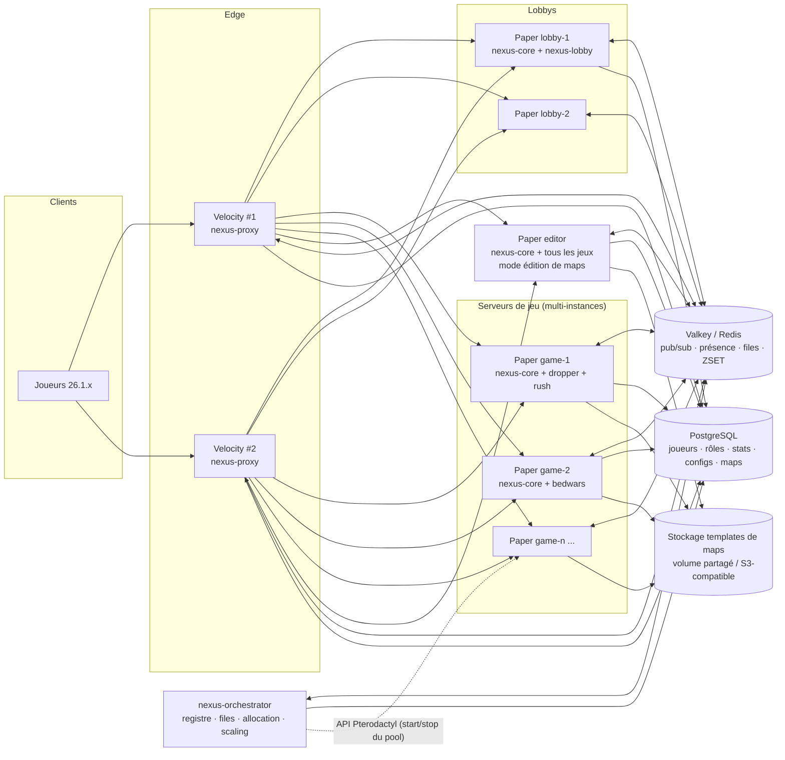
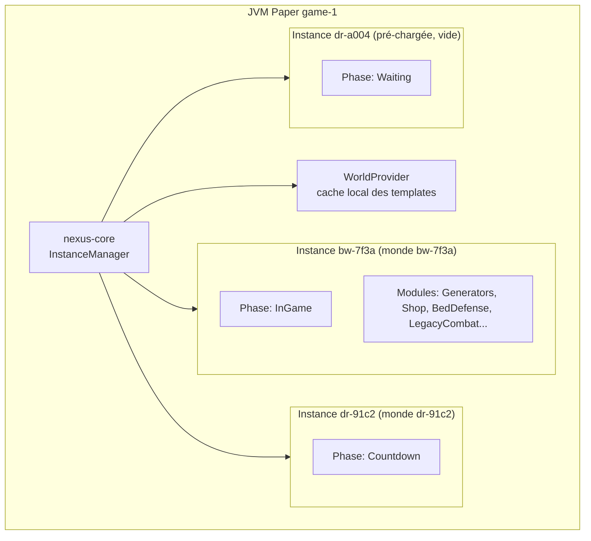
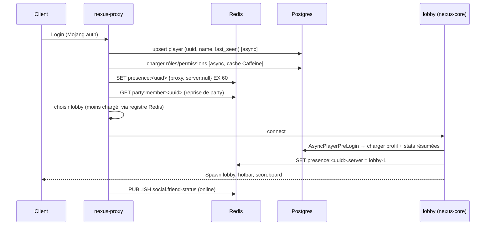
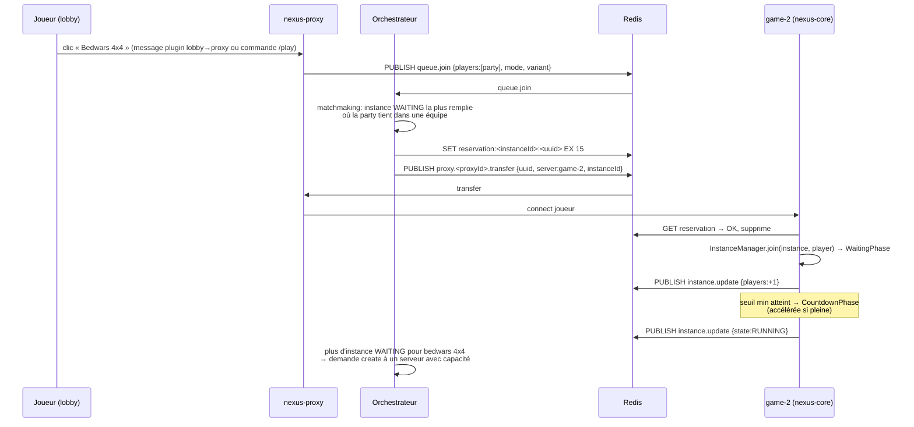

# 01 — Architecture

## 1. Vue d'ensemble

### Rôle de chaque composant

| Composant | Type | Responsabilités | Ne fait PAS |
|---|---|---|---|
| **nexus-proxy** | Plugin Velocity | Authentification, routage initial vers un lobby, exécution des transferts demandés par l'orchestrateur, party, amis, `/msg`, permissions côté proxy, présence (joueur → proxy/serveur). | Choisir une instance de jeu. |
| **nexus-orchestrator** | Service Java 25 autonome (serveur Pterodactyl, egg dédié) | Registre des serveurs (heartbeats), registre des instances, **files d'attente & matchmaking**, politique « toujours N instances joignables », création à la demande, **scaling** (provider pterodactyl en prod, static en dev), migrations Flyway, recalcul des leaderboards. | Parler aux clients Minecraft. |
| **nexus-core** | Plugin Paper (tous les serveurs Paper) | Profils joueurs, permissions, i18n, framework GUI/Dialog, **runtime des instances** (chargement monde, phases, équipes, modules), écriture des stats, admin UI, éditeur de maps (serveur `editor`). | Logique propre à un jeu. |
| **nexus-lobby** | Plugin Paper (lobbys) | Spawn, hotbar (sélecteur de jeux, profil, amis, party), PNJ/portails de jeux, hologrammes de leaderboards, parcours/attente. | — |
| **game-*** | Plugins Paper | Règles d'un mini-jeu via `nexus-api`. | I/O, files, monde, BDD. |
| **Valkey** | Infra | Bus temps réel, état éphémère (présence, parties, files, réservations), caches de leaderboards. | Stockage durable. |
| **PostgreSQL** | Infra | Données durables. | Bus de messages. |
| **Stockage templates** | Infra | Archives de mondes publiées (`.tar.zst`) + checksum. | — |

### Profils de serveurs

Chaque serveur Paper démarre avec `NEXUS_SERVER_TYPE` = `lobby` | `game` | `editor` et, pour `game`,
la liste des modes qu'il héberge est **déduite des plugins de jeu chargés**. Il s'annonce à l'orchestrateur
avec ses capacités (cf. `04-messaging-protocol.md` → `server.heartbeat`).

## 2. Modèle d'exécution d'un serveur de jeu

- **Une instance = un monde** (créé depuis un template, jamais sauvegardé, détruit à la fin).
- Le main thread Paper tique toutes les instances ; le **budget MSPT** est partagé → l'orchestrateur ne place une nouvelle instance que si le serveur a de la marge (score de capacité, cf. `05`).
- Les événements Bukkit sont routés vers l'instance concernée par un **dispatcher** (index `World → Instance`, `UUID joueur → Instance`) : un jeu ne voit **que** les événements de son instance.

## 3. Flux principaux

### 3.1 Connexion d'un joueur

### 3.2 File d'attente → partie (mode autonome)

### 3.3 Fin de partie

1. Le jeu appelle `ctx.end(GameResult)` (gagnants, classement, stats).
2. `EndPhase` : animation de victoire (5–10 s configurables), messages récap.
3. `nexus-core` construit un `MatchReport` et l'écrit **en une transaction** (`matches`, `match_participants`, upsert `player_stats` × périodes, `player_records`). En cas d'échec BDD → **journal local** (`plugins/NexusCore/pending-reports/*.json`) rejoué au redémarrage / toutes les 30 s.
4. Publie `match.finished` → l'orchestrateur invalide les caches de leaderboards concernés, le proxy propose « Rejouer ».
5. Les joueurs sont renvoyés au lobby (ou re-filés directement s'ils ont cliqué « Rejouer »).
6. Instance → `CLEANUP` : désenregistrement listeners/tâches, suppression entités, `unloadWorld(false)`, suppression du dossier. → `DESTROYED`, `instance.removed` publié.

### 3.4 Création à la demande

`/game create bedwars 4x4 map=Lighthouse preset=Rapide private` (ou menu admin) →
le core envoie `instance.create-request` à l'orchestrateur (avec `requestedBy`), qui choisit le serveur, crée
l'instance (`flags: PRIVATE, MANUAL_START`), renvoie un **code d'invitation** et téléporte le demandeur.
`/game start` force le démarrage même sous le minimum ; `/game stop` termine sans enregistrer de stats
(`GameResult.aborted()`).

## 4. Pannes et dégradations

| Panne | Détection | Comportement |
|---|---|---|
| Serveur de jeu crashé | heartbeat absent > 10 s | Orchestrateur marque `DEAD`, supprime ses instances, renvoie les joueurs (le proxy reçoit `KickedFromServerEvent` → lobby). Matchs en cours : pas de stats (aucun rapport émis). |
| Orchestrateur indisponible | heartbeat absent | Files suspendues (message « Matchmaking en maintenance »), parties en cours continuent. Les créations à la demande échouent proprement. Un 2e orchestrateur en **standby** prend la main via verrou Redis (`orchestrator:leader`, `SET NX PX`). |
| Redis indisponible | erreurs Lettuce | Parties en cours continuent ; joueurs restent où ils sont ; reconnexion automatique, ré-annonce complète des états au retour (`server.resync`). |
| Postgres indisponible | erreurs Hikari | Connexions de nouveaux joueurs : profil par défaut en lecture seule + message ; rapports de match en journal local. |
| Proxy crashé | — | Les joueurs de ce proxy sont déconnectés ; `presence:*` expire (TTL 60 s, rafraîchi toutes les 20 s). |

## 5. Sécurité

- Velocity **modern forwarding** avec secret ; les serveurs Paper n'écoutent que sur le réseau interne.
- Redis/Postgres jamais exposés ; Redis avec ACL et mot de passe ; un utilisateur Postgres applicatif sans droits DDL (sauf l'orchestrateur pour Flyway).
- Toute commande admin vérifie la permission **côté serveur qui exécute** (jamais de confiance dans un message Redis venant d'un client).
- Les messages Redis portent `origin` (id serveur) ; les commandes sensibles (`instance.force-stop`, `perm.*`) ne sont acceptées que si l'origine est un serveur enregistré.

## 6. Évolutions prévues

- Panneau web (lecture des mêmes schémas JSON de config, API REST exposée par l'orchestrateur).
- Provider Kubernetes pour le scaling (Pterodactyl est le provider de production, cf. `17-deploiement-pterodactyl.md`).
- Saisons de classement (`seasons` déjà prévu dans le schéma).
