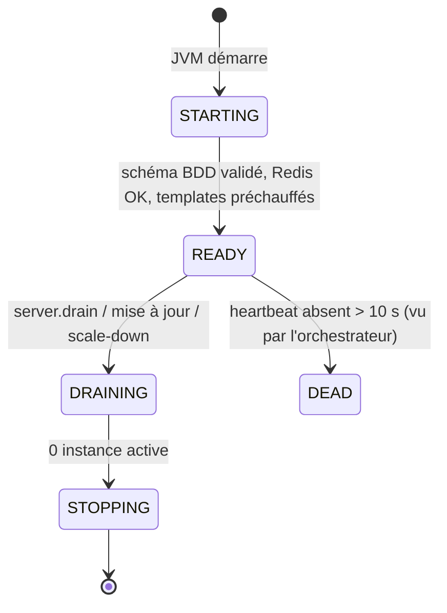
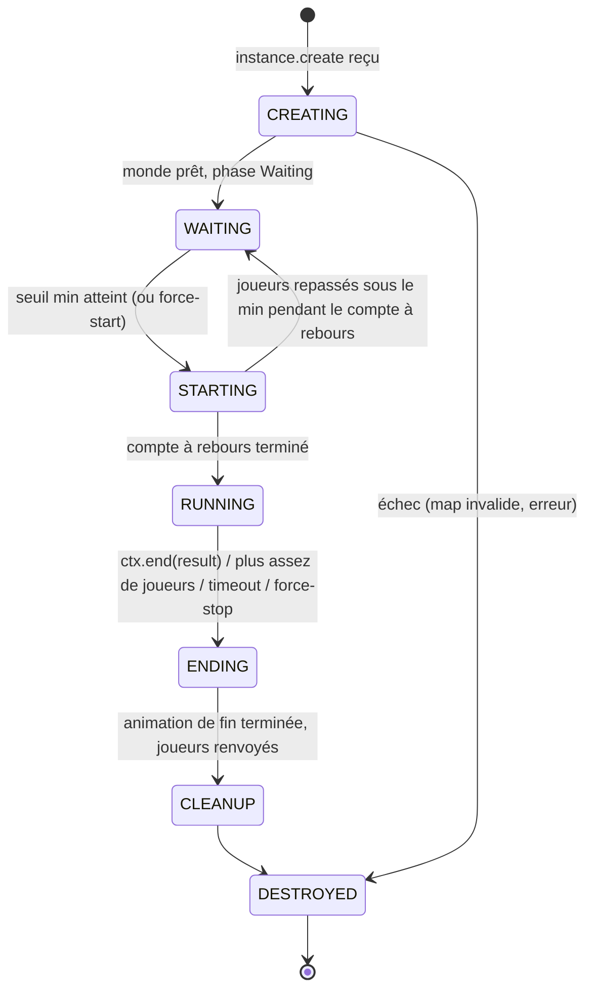

# 05 — Orchestration, instances & matchmaking

## 1. Cycle de vie d'un serveur



- Au `READY`, un serveur `game` **préchauffe** : télécharge (si absent ou checksum différent) les templates des maps actives de ses modes dans `cache/templates/`.
- `capacityScore` (0–100) calculé localement : `min(100 - msptP95*2, 100 * (1 - instances/maxInstances), 100 * freeMem/totalMem)`, borné. L'orchestrateur ne crée pas d'instance sur un serveur < 25.

## 2. Cycle de vie d'une instance



`GameState` (API) = `WAITING | STARTING | RUNNING | ENDING` ; `CREATING/CLEANUP/DESTROYED` sont internes au core.

**Joignable** = `WAITING` ou `STARTING` et places restantes, ou `RUNNING` si le mode autorise `lateJoin` (Dropper : non ; Bedwars : non ; rejoin ≠ lateJoin).

## 3. Mode autonome

L'orchestrateur exécute une **boucle de réconciliation** toutes les 500 ms (leader seulement) :

```
pour chaque (mode, variante) activée avec queue_enabled :
    waiting = instances WAITING/STARTING joignables
    besoin  = max(min_waiting_instances, ceil(joueursEnFile / maxPlayers))
    si |waiting| < besoin et aucune création en cours pour ce couple depuis < 3 s :
        serveur = AllocationPolicy.pick(mode, variante)   // §5
        si aucun : ScalingProvider.requestCapacity(mode)   // §6, + message « serveurs pleins » en file
        sinon    : envoyer instance.create (requête, timeout 5 s)
    Matchmaker.assign(file, waiting)                        // §4
```

### Compte à rebours (côté instance, configurable par mode)

| Situation | Durée |
|---|---|
| `players >= minPlayers` | `countdownSeconds` (déf. 30) |
| `players >= 75 % max` | réduit à `min(restant, 15)` |
| `players == max` | réduit à `min(restant, 5)` |
| `players < minPlayers` pendant le compte | annulation → `WAITING` |

Annonces : titre aux secondes 10, 5, 4, 3, 2, 1 + son, barre de boss de progression, compteur en action bar.

## 4. Matchmaking

### Entrées de file

```java
record QueueEntry(UUID entryId, List<UUID> players, @Nullable UUID partyId, ModeId mode, VariantId variant,
                  @Nullable String mapKey, Instant since) {}
```

Une party est **une seule entrée** (indivisible). Contrôles à l'entrée :
- seul le chef peut mettre la party en file ;
- `party.size <= variant.teamSize` → la party sera dans **la même équipe** ;
- `party.size > teamSize` mais `<= maxPlayers` → autorisé si le mode a `allowSplitParties` (sinon `PARTY_TOO_BIG`) ;
- un joueur ne peut être que dans **une** file à la fois (nouvelle file = remplace l'ancienne).

### Algorithme d'affectation (par couple mode/variante, FIFO pondéré)

1. Trier les entrées par ancienneté.
2. Pour chaque entrée, choisir l'instance joignable qui :
   a. a assez de places **et** une équipe pouvant accueillir la party entière (simulation via `TeamAssigner`),
   b. a le **plus de joueurs** (remplir avant d'ouvrir — réduit l'attente),
   c. à égalité, la plus ancienne.
3. Créer les `reservation:*` (TTL 15 s), envoyer `player.transfer` au proxy, marquer l'entrée `FOUND`.
4. Si la réservation n'est pas consommée (joueur parti, transfert échoué) → libérée à expiration, entrée remise en tête de file.
5. Les places réservées comptent dans `players` de l'instance (le serveur les connaît via `reservation:*` et le message de l'orchestrateur).

> Pas d'ELO/MMR en v1 (hors scope). Le `Matchmaker` est une interface pour pouvoir le brancher plus tard.

### Placement en équipe (côté instance)

`TeamAssigner` (API, remplaçable par jeu) : à l'arrivée, les membres d'une même party vont dans la même équipe ;
sinon équipe la moins remplie ; au démarrage, rééquilibrage final (sans casser les parties) ; les joueurs solo complètent.

## 5. Politique d'allocation (choix du serveur)

`AllocationPolicy.pick(mode, variante)` :
1. Serveurs `READY`, type `game`, qui hébergent le mode, `capacityScore >= 25`, `instances < maxInstances`.
2. Score = `capacityScore` − 10 × (instances du même mode déjà présentes, pour répartir) + 15 si le template de la map choisie est déjà en cache local.
3. Le meilleur score gagne ; à égalité, le moins de joueurs.

Choix de la map : si non imposée → tirage pondéré (`maps.weight`) parmi les maps `ACTIVE` compatibles avec la variante, en excluant les 2 dernières jouées sur ce couple.

## 6. Scaling

```java
public interface ScalingProvider {
    void requestCapacity(ModeId mode);      // demande au moins un serveur supplémentaire hébergeant ce mode
    void releaseIdle(Duration idleFor);     // propose l'arrêt des serveurs vides depuis longtemps
}
```

| Provider | Comportement |
|---|---|
| **`pterodactyl`** (production, ADR-010) | **Mode pool** : serveurs `game` pré-créés et arrêtés (External ID `nexus-game-<n>`) ; `requestCapacity` démarre le premier serveur arrêté du pool (API Client `power: start`), `releaseIdle` draine puis arrête les serveurs vides depuis `idle-shutdown-minutes` en gardant `min-running`. Mode `create` optionnel (API Application). Détails : `17-deploiement-pterodactyl.md` §6. |
| `static` | Pool fixe toujours allumé ; `requestCapacity` = log + alerte staff. Utilisé en dev. |
| `docker` | Optionnel (expérimentation) : démarre des conteneurs via l'API Docker. |

Un serveur démarré par le provider n'est pas utilisable tout de suite : l'orchestrateur le considère `PENDING` jusqu'à son premier heartbeat `READY` (timeout 120 s → alerte, serveur suivant du pool). Les serveurs démarrés dynamiquement s'enregistrent seuls via heartbeat → **aucune config proxy** : Velocity permet d'ajouter des serveurs à la volée (`ProxyServer#registerServer`), fait par `nexus-proxy` à la réception d'un serveur inconnu dans le registre.

## 7. Lancement à la demande

| Qui | Comment | Limites |
|---|---|---|
| Admin (`nexus.game.create`) | `/game create <mode> [variante] [map=] [preset=] [private] [unranked]` ou Hub admin → « Créer une partie » (formulaire Dialog) | aucune |
| Joueur VIP (`nexus.game.create.private`) | Menu party → « Partie privée » | 1 instance privée active par joueur ; preset parmi ceux marqués `hostable` ; réglages hôte limités aux options `@Setting(hostEditable = true)` ; toujours `unranked` |

Commandes de gestion d'une instance (dans l'instance, ou `--id <instanceId>`) :
`/game start` (`nexus.instance.start`), `/game stop [raison]` (`nexus.instance.stop`), `/game invite <joueur>`, `/game code`,
`/game kick <joueur>` (`nexus.instance.kick`), `/game settings` (ouvre la config hôte), `/join <code>`.

Une instance forcée à démarrer sous le `min_players` est automatiquement **`unranked`**.

## 8. Reconnexion

Si `rejoinWindowSeconds > 0` pour le mode et le joueur quitte en `RUNNING` sans être éliminé :
- `rejoin:<uuid>` = instanceId (TTL = fenêtre) ; le joueur est marqué `DISCONNECTED` dans l'instance (le jeu décide : son lit protège-t-il encore, ses ressources restent-elles…) ;
- à sa reconnexion au réseau, le proxy propose « Rejoindre ta partie » (clic) ou le renvoie directement si `autoRejoin` ;
- à expiration : `PlayerEliminatedEvent(reason = DISCONNECTED)` et outcome `LEFT`.

## 9. Haute disponibilité de l'orchestrateur

- 2 instances possibles ; élection par `SET orchestrator:leader <id> NX PX 5000`, renouvelée chaque seconde.
- Le leader écrit `queue:snapshot` toutes les secondes ; le suivant le recharge à la prise de leadership puis publie `server.resync`.
- Les serveurs n'adressent jamais un orchestrateur précis : ils publient sur `nexus:orchestrator`, seul le leader traite.
