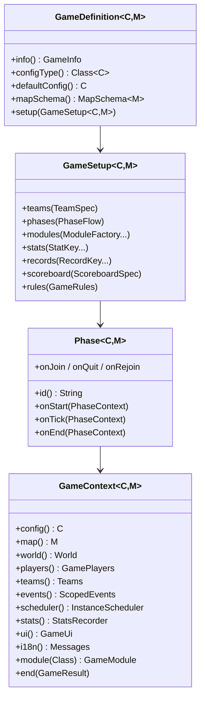

# 06 — API des mini-jeux (`nexus-api`)

> Objectif : un développeur qui ne connaît que ce document peut créer un mini-jeu complet.
> Principe : **le jeu déclare, le runtime orchestre**. Le jeu ne charge pas de monde, ne gère pas de file,
> n'écrit pas en BDD, ne téléporte pas au lobby.

## 1. Vue d'ensemble



Un **mode** (`bedwars`) a des **variantes** (`8x1`, `4x4`, en BDD), des **presets de config** (`classic`, `fast`) et des **maps**.
Une **instance** = une partie en cours = (mode, variante, preset, map, monde, joueurs).

## 2. Enregistrer un jeu

```java
public final class DropperBootstrap extends JavaPlugin {
    @Override public void onEnable() {
        NexusApi.games().register(this, new DropperDefinition());
    }
}
```

`paper-plugin.yml` :
```yaml
name: NexusGame-Dropper
version: '${version}'
main: fr.nexus.game.dropper.DropperBootstrap
api-version: '26.1'
load: POSTWORLD
dependencies:
  server:
    NexusCore: { load: BEFORE, required: true, join-classpath: true }
```

Au chargement, le core vérifie : version majeure de l'API, `ModeId` présent dans `game_modes` (sinon log + mode désactivé),
config par défaut valide vis-à-vis de ses bornes, schéma de map cohérent.

## 3. `GameDefinition`

```java
public interface GameDefinition<C extends GameConfig, M extends MapData> {
    GameInfo info();                 // id, nom, description (clés i18n), icône, tags
    Class<C> configType();
    C defaultConfig();               // valeurs par défaut — utilisées par l'UI admin et pour compléter les configs partielles
    MapSchema<M> mapSchema();
    void setup(GameSetup<C, M> setup);   // appelé UNE fois par instance, avant WAITING
}
```

### `GameSetup` — tout ce qu'un jeu peut déclarer

| Méthode | Rôle |
|---|---|
| `teams(TeamSpec)` | `TeamSpec.solo()`, `TeamSpec.fromVariant(TeamColor...)` (nb/taille lus de la variante), `friendlyFire(bool)`, `nameTags(...)`, `collision(...)` |
| `phases(PhaseFlow)` | ordre des phases ; `PhaseFlow.standard(mainPhase)` = Waiting → Countdown → main → End |
| `modules(ModuleFactory...)` | modules activés pour **toute** l'instance (une phase peut aussi activer des modules pour sa durée) |
| `stats(StatKey...)` | stats propres au jeu (wins/losses/played sont automatiques) |
| `records(RecordKey...)` | records personnels (meilleur temps…) |
| `scoreboard(ScoreboardSpec)` | lignes dynamiques (le core gère l'en-tête, le pied et la mise à jour différentielle) |
| `rules(GameRules)` | `lateJoin`, `rejoinWindow`, `minPlayersToContinue`, `allowSplitParties`, `spectateOnElimination`, `maxDuration` |
| `lobbyItems(...)` | items de la hotbar en phase d'attente (choix d'équipe, kit…) |

## 4. Le contexte (`GameContext<C, M>`)

Toujours **main thread** sauf mention `@AnyThread`.

| Méthode | Description |
|---|---|
| `config()` | config typée **immuable** pour la durée de l'instance (un changement admin s'applique aux parties suivantes) |
| `map()` | données de map typées, coordonnées **déjà converties** en `Location` dans le monde de l'instance |
| `world()` | monde de l'instance |
| `players()` | `all()`, `alive()`, `spectators()`, `get(UUID)`, `online()`, `count()` |
| `teams()` | `all()`, `alive()`, `of(GamePlayer)`, `byColor(TeamColor)` |
| `events()` | bus scopé : `on(Class<E extends Event>, handler)`, `on(..., EventPriority, ignoreCancelled)` — ne reçoit **que** les événements de l'instance ; désinscription automatique |
| `scheduler()` | `every(ticks, task)`, `after(ticks, task)`, `countdown(seconds, onSecond, onDone)` — annulés à la fin de la phase/instance |
| `stats()` | `increment(player, key)`, `add(player, key, n)`, `max(...)`, `record(player, recordKey, value)` |
| `ui()` | `title`, `actionBar`, `bossBar(id)`, `sound`, `hologram(...)`, `scoreboard().refresh()` |
| `i18n()` | `send(player, "key", placeholders...)`, `broadcast("key", ...)` (chaque joueur dans sa langue) |
| `module(Class<T>)` | accès à un module actif |
| `random()` | `RandomGenerator` seedé par match (reproductibilité des tests) |
| `clock()` | ticks écoulés depuis le début de la phase/partie |
| `end(GameResult)` | termine la partie (idempotent) |

### `GamePlayer`

```java
public interface GamePlayer {
    UUID id();
    String name();
    @Nullable Player bukkit();          // null si DISCONNECTED
    PlayerState state();                // ALIVE, SPECTATOR, ELIMINATED, DISCONNECTED
    @Nullable Team team();
    <T> T data(PlayerKey<T> key);       // stockage par joueur, typé, scopé à l'instance
    <T> void data(PlayerKey<T> key, T value);
    void eliminate(EliminationReason reason);
    void respawnAt(Location loc);
    void giveKit(Kit kit);
}
```

`PlayerKey<T>` : `public static final PlayerKey<Integer> CHECKPOINT = PlayerKey.of("checkpoint", Integer.class, 0);`

## 5. Phases

```java
public interface Phase<C extends GameConfig, M extends MapData> {
    String id();
    default void onStart(PhaseContext<C, M> ctx) {}
    default void onTick(PhaseContext<C, M> ctx) {}        // fréquence : tickInterval() (déf. 20 ticks)
    default int tickInterval() { return 20; }
    default void onEnd(PhaseContext<C, M> ctx) {}
    default void onJoin(PhaseContext<C, M> ctx, GamePlayer p) {}
    default void onQuit(PhaseContext<C, M> ctx, GamePlayer p) {}
    default void onRejoin(PhaseContext<C, M> ctx, GamePlayer p) {}
    default @Nullable Duration timeLimit(C config) { return null; }  // à expiration : onTimeout
    default void onTimeout(PhaseContext<C, M> ctx) { ctx.next(); }
}
```

`PhaseContext` = `GameContext` + `next()` (phase suivante), `goTo(String id)`, `events()`/`scheduler()` **scopés à la phase**, `modules(...)` à la durée de la phase.

Phases fournies : `WaitingPhase` (hotbar d'attente, choix d'équipe, spawn d'attente lu dans la map), `CountdownPhase` (règles §3 de `05`), `EndPhase` (feux d'artifice, récap, retour lobby), `SuddenDeathPhase` (utilitaire générique).

## 6. Modules réutilisables

Un module = un comportement autonome, configurable, activable par jeu ou par phase.

```java
public interface GameModule {
    default void enable(GameContext<?, ?> ctx) {}
    default void disable(GameContext<?, ?> ctx) {}
}
// déclaration
setup.modules(ctx -> new VoidDeathModule(ctx.map().voidY()),
              ctx -> new RespawnModule(Duration.ofSeconds(ctx.config().respawnSeconds()), p -> p.team().hasBed()));
```

| Module | Fait | Paramètres principaux |
|---|---|---|
| `DeathPipelineModule` *(toujours actif)* | Intercepte les dégâts létaux (pas d'écran de mort), attribue le tueur (dernier attaquant < 10 s), émet `GamePlayerDeathEvent` | fenêtre d'attribution |
| `VoidDeathModule` | Mort sous un Y (filtre changement de bloc) | `y` |
| `RespawnModule` | Respawn après délai (spectateur pendant le délai, compte à rebours titre), sinon élimination | délai, condition, point de respawn |
| `SpectatorModule` | Mode spectateur propre (invisible, vol, menu de téléportation vers joueurs vivants) | — |
| `NoHungerModule` / `HungerModule` | Faim figée ou normale | — |
| `DamageRulesModule` | Désactive des causes (chute, feu…), PvP on/off, friendly fire | causes |
| `BuildRulesModule` | Ne casser que les blocs posés, hauteur max/min, régions protégées (spawns, générateurs), liste de blocs autorisés | régions de la map, limites |
| `GeneratorModule` | Générateurs de ressources depuis marqueurs, paliers, hologrammes, plafond d'items au sol, partage d'équipe | définitions de générateurs |
| `ShopModule` | Boutique PNJ (Mannequin/Villager sans IA) + menus, monnaies = items, catégories, achats rapides | catalogue (`ShopCatalog` DSL) |
| `BedModule` | Lits d'équipe depuis marqueurs, protection du lit allié, destruction → `BedDestroyedEvent`, animation | — |
| `TeamChatModule` | Chat d'équipe par défaut, `!` pour le chat global | préfixe |
| `KitModule` | Kits de départ / respawn, outils persistants avec paliers | kits |
| `LegacyCombatModule` | PvP 1.8 (cf. `10-pvp-legacy.md`) | `CombatProfile`, `KnockbackProfile` |
| `TimeLimitModule` | Limite globale + hook « mort subite » | durée |
| `WorldBorderModule` | Bordure (option rétrécissement) | taille, durée |
| `CheckpointModule` | Points de passage, retour au dernier checkpoint | marqueurs |

Règle : **si un comportement est utile à deux jeux, il devient un module de l'API.**

## 7. Config typée → UI admin automatique

```java
@ConfigSchema(version = 1)
public record DropperConfig(
    @Setting(category = "general", label = "dropper.cfg.levels", description = "dropper.cfg.levels.desc", order = 1)
    @Range(min = 1, max = 10) int levels,

    @Setting(category = "general", label = "dropper.cfg.time_limit", description = "dropper.cfg.time_limit.desc", order = 2, unit = Unit.SECONDS)
    @Range(min = 60, max = 1800, step = 30) int timeLimitSeconds,

    @Setting(category = "rules", label = "dropper.cfg.fail_action", order = 1, hostEditable = true)
    FailAction failAction,                     // enum → sélection

    @Setting(category = "rules", label = "dropper.cfg.max_fails", order = 2)
    @Range(min = 0, max = 50) int maxFailsPerLevel  // 0 = illimité (décrit dans la description)
) implements GameConfig {}
```

| Type Java | Rendu UI | Annotations |
|---|---|---|
| `boolean` | interrupteur (Dialog `bool`) | — |
| `int`, `long`, `double` | curseur (Dialog `numberRange`) | `@Range(min, max, step)` obligatoire |
| `String` | champ texte | `@Length(max)`, `@Pattern` |
| `enum` (implémente `Labeled`) | choix (Dialog `singleOption`) | libellés i18n par constante |
| `Duration` | curseur en secondes | `@Range`, `unit` |
| `ItemType` / `Material` | sélecteur d'item (menu inventaire) | `@AllowedItems` optionnel |
| record imbriqué | sous-catégorie | — |
| `List<record>` | liste éditable (ajouter/supprimer/réordonner) dans un menu | `@Size(min, max)` |

- `label`/`description` sont des **clés i18n** (FR obligatoire).
- `hostEditable = true` : modifiable par l'hôte d'une partie privée.
- `@Advanced` : caché derrière « Options avancées ».
- Validation croisée : `GameConfig#validate()` retourne une liste d'erreurs i18n (ex. « le temps de respawn doit être < durée de la partie »).
- Stockage : JSON complet en BDD ; les champs manquants prennent la valeur de `defaultConfig()` ; les champs inconnus sont ignorés (warning) ; `version` du schéma permet une `ConfigMigration` explicite si un champ change de sens.

## 8. Schéma de map

```java
public final class DropperMapSchema implements MapSchema<DropperMap> {
    public static final MarkerType WAITING_SPAWN = MarkerType.point("waiting_spawn").label("map.marker.waiting_spawn").withRotation().exactly(1);
    public static final MarkerType LEVEL_START   = MarkerType.point("level_start").indexed().label("dropper.marker.level_start").withRotation().atLeast(1);
    public static final RegionType LEVEL_FINISH  = RegionType.cuboid("level_finish").indexed().label("dropper.marker.level_finish");
    public static final MetaField<Integer> VOID_Y = MetaField.integer("void_y", -64, -64, 320);

    @Override public List<MarkerType> markers() { return List.of(WAITING_SPAWN, LEVEL_START); }
    @Override public List<RegionType> regions() { return List.of(LEVEL_FINISH); }
    @Override public List<MetaField<?>> meta() { return List.of(VOID_Y); }

    @Override public List<ValidationError> validate(MapView map, @Nullable Variant variant) {
        return map.count(LEVEL_START) == map.count(LEVEL_FINISH) ? List.of()
             : List.of(ValidationError.of("dropper.map.levels_mismatch"));
    }

    @Override public DropperMap bind(MapView map) {
        return new DropperMap(map.point(WAITING_SPAWN), map.indexedPoints(LEVEL_START), map.indexedRegions(LEVEL_FINISH), map.meta(VOID_Y));
    }
}
```

Types de marqueurs : `point` (position + rotation optionnelle), `block` (position de bloc, ex. lit — orientation lue du bloc), `region` (cuboïde 2 points).
Modificateurs : `perTeam()` (un par équipe de la variante, couleur associée), `indexed()` (ordonnés : niveaux, checkpoints), `exactly/atLeast/atMost(n)`.
L'éditeur de maps (`07-admin-config-ui.md`) génère ses outils **à partir de ce schéma**.

## 9. Stats et résultat

```java
public final class BedwarsStats {
    public static final StatKey KILLS       = StatKey.sum("kills", "bedwars.stat.kills").leaderboard();
    public static final StatKey FINAL_KILLS = StatKey.sum("final_kills", "bedwars.stat.final_kills").leaderboard();
    public static final StatKey BEDS_BROKEN = StatKey.sum("beds_broken", "bedwars.stat.beds_broken").leaderboard();
    public static final StatKey DEATHS      = StatKey.sum("deaths", "bedwars.stat.deaths");
}
public final class DropperRecords {
    public static RecordKey bestTime(String mapKey) { return RecordKey.lowerIsBetter("best_time:" + mapKey, "dropper.record.best_time").format(Format.DURATION_MS); }
}

ctx.stats().increment(killer, BedwarsStats.KILLS);
ctx.stats().record(player, DropperRecords.bestTime(ctx.map().key()), elapsedMs);

ctx.end(GameResult.teamWin(team));                 // WIN pour l'équipe, LOSS pour les autres
ctx.end(GameResult.ranking(List.of(first, second, third)));  // placements
ctx.end(GameResult.draw());
ctx.end(GameResult.aborted("reason.key"));         // pas de stats, match non classé
```

Automatique : `games_played`, `wins`, `losses`, `draws`, `playtime_s`, `win_streak`, `best_win_streak` ; outcome `LEFT` pour un joueur parti sans revenir.

## 10. Événements Nexus (à préférer aux événements Bukkit bruts)

| Événement | Quand |
|---|---|
| `GamePlayerJoinEvent` / `GamePlayerQuitEvent` / `GamePlayerRejoinEvent` | arrivée/départ dans l'instance |
| `GamePlayerDeathEvent` | mort interceptée (victime, tueur?, assistants, cause, `isFinal` réglable par le jeu) |
| `PlayerEliminatedEvent` / `TeamEliminatedEvent` | élimination |
| `PhaseChangeEvent` | changement de phase |
| `GameStartEvent` / `GameEndEvent` | début/fin |
| `BedDestroyedEvent`, `ShopPurchaseEvent`, `GeneratorTierUpEvent` | émis par les modules |

Les événements Bukkit restent disponibles via `ctx.events().on(BlockPlaceEvent.class, ...)`, **filtrés sur l'instance**.

## 11. Exemple complet — Dropper (simplifié)

```java
public final class DropperDefinition implements GameDefinition<DropperConfig, DropperMap> {
    @Override public GameInfo info() { return GameInfo.of("dropper", "dropper.name").icon(ItemType.FEATHER).description("dropper.desc"); }
    @Override public Class<DropperConfig> configType() { return DropperConfig.class; }
    @Override public DropperConfig defaultConfig() { return new DropperConfig(5, 600, FailAction.RESTART_LEVEL, 0); }
    @Override public MapSchema<DropperMap> mapSchema() { return new DropperMapSchema(); }

    @Override public void setup(GameSetup<DropperConfig, DropperMap> g) {
        g.teams(TeamSpec.solo())
         .rules(GameRules.defaults().rejoinWindow(Duration.ofSeconds(60)))
         .records(DropperRecords.ALL_LEVELS)
         .modules(ctx -> new NoHungerModule(),
                  ctx -> new DamageRulesModule().disableAll(),
                  ctx -> new BuildRulesModule().denyAll())
         .scoreboard(ScoreboardSpec.lines(
                  ctx -> Line.i18n("dropper.sb.level", ctx.players().self().data(DropperKeys.LEVEL) + 1, ctx.config().levels()),
                  ctx -> Line.i18n("dropper.sb.time", Format.duration(ctx.clock().elapsed()))))
         .phases(PhaseFlow.standard(new RacePhase()));
    }
}

final class RacePhase implements Phase<DropperConfig, DropperMap> {
    @Override public String id() { return "race"; }
    @Override public Duration timeLimit(DropperConfig c) { return Duration.ofSeconds(c.timeLimitSeconds()); }

    @Override public void onStart(PhaseContext<DropperConfig, DropperMap> ctx) {
        ctx.players().alive().forEach(p -> p.respawnAt(ctx.map().levelStart(0)));
        ctx.events().on(PlayerMoveEvent.class, e -> {
            if (!e.hasChangedBlock()) return;
            GamePlayer p = ctx.players().get(e.getPlayer().getUniqueId());
            int level = p.data(DropperKeys.LEVEL);
            if (ctx.map().levelFinish(level).contains(e.getTo())) onLevelDone(ctx, p, level);
            else if (e.getTo().getY() < ctx.map().voidY()) fail(ctx, p, level);
        });
    }

    private void onLevelDone(PhaseContext<DropperConfig, DropperMap> ctx, GamePlayer p, int level) {
        if (level + 1 >= ctx.config().levels()) {
            ctx.stats().record(p, DropperRecords.ALL_LEVELS, ctx.clock().elapsedMillis());
            ctx.end(GameResult.ranking(DropperRanking.of(ctx)));     // logique pure, testée
            return;
        }
        p.data(DropperKeys.LEVEL, level + 1);
        p.respawnAt(ctx.map().levelStart(level + 1));
        ctx.ui().sound(p, Sounds.LEVEL_UP);
    }

    private void fail(PhaseContext<DropperConfig, DropperMap> ctx, GamePlayer p, int level) {
        p.respawnAt(ctx.map().levelStart(ctx.config().failAction() == FailAction.RESTART_ALL ? 0 : level));
    }

    @Override public void onTimeout(PhaseContext<DropperConfig, DropperMap> ctx) {
        ctx.end(GameResult.ranking(DropperRanking.of(ctx)));
    }
}
```

## 12. Ajouter un jeu en 10 étapes

1. Rédiger `docs/games/<id>.md` depuis `docs/games/_template.md`.
2. Ajouter le mode et ses variantes par une **nouvelle migration** (`INSERT INTO game_modes / game_variants`).
3. `/new-minigame <id>` (Claude Code) ou copier `games/game-dropper` et renommer.
4. Écrire le record de **config** annoté + `defaultConfig()`.
5. Écrire le **schéma de map** (marqueurs, régions, méta, validation) + record `MapData`.
6. Déclarer **stats** et **records**.
7. Écrire la/les **phase(s)** principales en réutilisant les **modules**.
8. Mettre la logique de règles dans `logic/` (Java pur) + tests JUnit / `FakeGameContext`.
9. Fichiers `lang/fr_FR.yml` + `en_US.yml`.
10. Construire une map sur le serveur `editor`, la publier, activer le mode dans le Hub admin → le mode apparaît dans le lobby.

## 13. Tests (`nexus-api-testkit`)

```java
var ctx = FakeGameContext.<DropperConfig, DropperMap>builder(new DropperDefinition())
        .players(3).map(TestMaps.dropperThreeLevels()).build();
ctx.startPhase("race");
ctx.player(0).data(DropperKeys.LEVEL, 2);
ctx.advanceTicks(20 * 30);
assertThat(ctx.result()).isEmpty();
```

`FakeGameContext` fournit des joueurs factices (sans Bukkit), une horloge pilotable, la capture des stats, messages et résultats.
Les interactions monde/entités restent testées manuellement sur le serveur de dev (checklist dans chaque spec de jeu).
