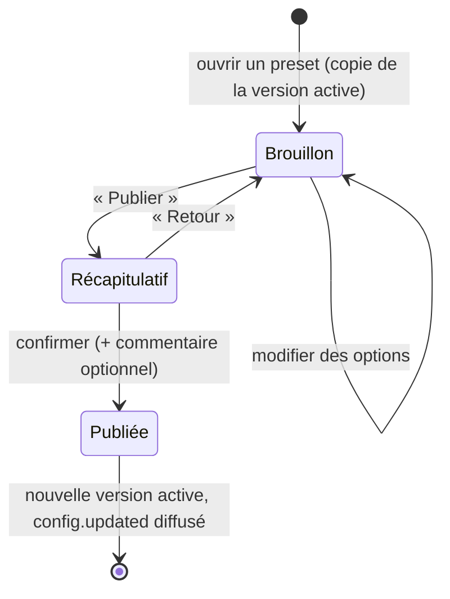

# 07 — Interfaces d'administration & configuration

## 1. Principes d'ergonomie (s'appliquent à tous les écrans)

1. **Zéro fichier à éditer** pour un admin de jeu : tout se fait en jeu.
2. **Un écran = une question.** Navigation : Hub → Mode → Preset → Catégorie → Option.
3. Chaque option affiche **libellé, description, valeur actuelle, valeur par défaut, bornes** et, si modifiée, un marqueur « ● modifié ».
4. **Rien n'est appliqué sans confirmation** : les modifications vont dans un **brouillon** ; l'écran « Récapitulatif » montre le diff (ancien → nouveau) avant publication.
5. Annuler est toujours possible : « Réinitialiser cette option », « Abandonner le brouillon », « Revenir à la version N ».
6. Langage métier, pas technique : « Temps avant réapparition : 5 s », pas `respawnSeconds=5`.
7. Couleurs cohérentes : vert = valider, rouge = supprimer/annuler, jaune = modifié, gris = défaut.
8. Tout est **permissionné** et **audité** (`audit_log`).

## 2. Briques techniques

| Brique | Usage | Implémentation |
|---|---|---|
| **Menus inventaire** (`Menu`) | navigation, listes, sélection d'items | framework maison léger dans `nexus-core/ui` : pages, boutons, pagination, rafraîchissement partiel, `InventoryHolder` dédié, clics anti-double |
| **Dialogs Paper** (`DialogForm`) | saisie de valeurs (curseurs, interrupteurs, choix, texte), confirmations | API Dialog de Paper (`Dialog.create`, `DialogBase`, `DialogInput.bool/numberRange/singleOption/text`, `DialogAction.customClick(callback)`) |
| **Display entities** | aperçus dans le monde (marqueurs de map, zones) | `TextDisplay`, `BlockDisplay`, `ItemDisplay`, visibles seulement pour l'éditeur (`setVisibleByDefault(false)` + `player.showEntity`) |
| **Commandes Brigadier** | accès direct, scripts, console | `LifecycleEvents.COMMANDS`, auto-complétion contextuelle (modes, presets, maps) |

### Rendu automatique d'une catégorie de config en Dialog

```
┌────────────── Bedwars · Preset « Classique » · Générateurs ──────────────┐
│ Configure la vitesse des générateurs de ta map.                           │
│                                                                           │
│ Fer — intervalle (s)           [====●==========]  1.0 s   (défaut 1.0)    │
│ Or — intervalle (s)            [=========●=====]  6.0 s   (défaut 6.0)    │
│ Diamant palier I (s)           [==========●====] 30 s  ● modifié (déf 30) │
│ Partage des ressources équipe  [✔]                                        │
│ Plafond d'items par générateur [=====●=========]  48                      │
│                                                                           │
│    [ Enregistrer dans le brouillon ]   [ Valeurs par défaut ]   [ Retour ] │
└───────────────────────────────────────────────────────────────────────────┘
```

- Chaque `@Setting` de la catégorie devient un `DialogInput` (mapping au §7 de `06-game-api.md`).
- Les catégories trop longues (> 8 options) sont paginées automatiquement.
- `List<record>` et `ItemType` ouvrent un **menu inventaire** dédié (le Dialog ne sait pas faire de liste dynamique).
- La validation (`@Range`, `validate()`) s'exécute au clic « Enregistrer » ; les erreurs réaffichent le Dialog avec un message en tête.

## 3. Hub admin — `/admin` (perm `nexus.admin.hub`)

```
Hub admin
├─ Réseau            serveurs (type, joueurs, instances, MSPT, mémoire, état) → Drainer / Arrêter
├─ Parties en cours  par mode → instance (joueurs, phase, durée) → Observer / Forcer démarrage / Arrêter / Expulser
├─ Créer une partie  formulaire Dialog : mode, variante, map, preset, privée, non classée, invités
├─ Modes de jeu      activer/désactiver mode ou variante, ordre d'affichage, min instances en attente
│   └─ Configs       presets → catégories → options (§2) ; historique, rollback, dupliquer preset
├─ Maps              par mode : liste, statut, versions, poids de rotation → Activer/Désactiver, Éditer (téléporte sur le serveur editor)
├─ Rôles             liste, créer, éditer (préfixe, couleur, poids, parent), permissions (ajout avec auto-complétion du catalogue)
├─ Joueurs           recherche → profil, rôles (ajout temporaire), stats, historique
└─ Journal           dernières actions auditées
```

## 4. Cycle de publication d'une config



- Les brouillons sont stockés **en mémoire** sur le serveur de l'admin (perdus à la déconnexion après avertissement) — pas de table dédiée en v1.
- Publication = transaction décrite dans `03-database.md` §3.
- Les instances déjà créées gardent leur config ; les **prochaines** instances utilisent la nouvelle (affiché dans le récapitulatif).
- Presets : dupliquer, renommer, marquer `hostable` (choisissable en partie privée), choisir le preset par défaut de chaque variante.

## 5. Éditeur de maps (serveur `editor`)

Accès : `/map edit <mode> <map>` ou Hub → Maps → Éditer (perm `nexus.map.edit`). Le proxy envoie le joueur sur le serveur `editor`, qui charge le monde de travail.

### Création

`/map create <mode> <clé> [nom]` → monde vide (générateur void) **ou** `/map import <mode> <clé> <dossier>` (monde déposé dans `editor/imports/`).

### Outils générés depuis le `MapSchema`

À l'ouverture, le builder reçoit une **hotbar d'outils** :

| Slot | Outil | Action |
|---|---|---|
| 1 | **Baguette de marqueurs** | clic droit : ouvre la liste des marqueurs du schéma (icône, libellé, compteur `2/4`) ; choisir un type puis clic droit sur un bloc = placer ; clic gauche sur un marqueur existant = supprimer |
| 2 | **Outil de région** | 2 clics = cuboïde pour le `RegionType` sélectionné, aperçu en `BlockDisplay` translucide |
| 3 | **Équipe** (si `perTeam`) | cycle de la couleur d'équipe courante |
| 4 | **Méta** | Dialog des `MetaField` (Y du vide, heure, météo, nom affiché, auteurs) |
| 8 | **Checklist** | menu : tous les éléments requis, ✔/✘, clic = téléporter au marqueur |
| 9 | **Publier** | lance la validation puis la publication |

- Chaque marqueur placé est matérialisé par un `TextDisplay` (libellé + couleur d'équipe, toujours face au joueur — billboard `CENTER`) et un `ItemDisplay` (icône), visibles **uniquement** par les éditeurs.
- Une **boss bar** indique la progression (« 18 / 22 éléments requis »).
- Les positions sont stockées **relatives à l'origine de la map** (marqueur implicite `origin`, défaut 0,0,0) pour permettre le déplacement du template.

### Publication

1. `MapSchema#validate` pour chaque variante compatible → erreurs listées en clair, cliquables (téléportation).
2. Sauvegarde du monde, nettoyage (suppression des entités d'édition, `level.dat` normalisé, suppression `playerdata`, `entities` si non requis).
3. Archive `.tar.zst` + SHA-256 → stockage templates (`<mode>/<map>/<version>.tar.zst`).
4. Transaction : `map_versions` (+ `maps.current_version`, statut `ACTIVE` si demandé) + audit.
5. `map.published` → les serveurs de jeu préchargent la nouvelle version.

## 6. Interfaces joueurs liées

- **Sélecteur de jeux** (lobby) : menu par mode → variantes avec nombre de joueurs en file / en jeu (rafraîchi toutes les 2 s, données Redis).
- **Profil** : stats par mode (onglets), records, historique des 10 dernières parties.
- **Leaderboards** : menu (mode, variante, période, stat) + hologrammes du lobby.
- **Partie privée** (hôte) : Dialog avec uniquement les options `hostEditable`.

## 7. Commandes (résumé)

| Commande | Permission |
|---|---|
| `/admin` | `nexus.admin.hub` |
| `/game create|start|stop|invite|kick|settings|code` | `nexus.game.create`, `nexus.instance.start|stop|kick` |
| `/config <mode> [preset]` | `nexus.config.edit` |
| `/config history <mode> <preset>` / `rollback <version>` | `nexus.config.rollback` |
| `/map create|import|edit|publish|list|disable` | `nexus.map.*` |
| `/role ...` (cf. `08`) | `nexus.role.*` |
| `/spectate <joueur>` | `nexus.spectate` |
