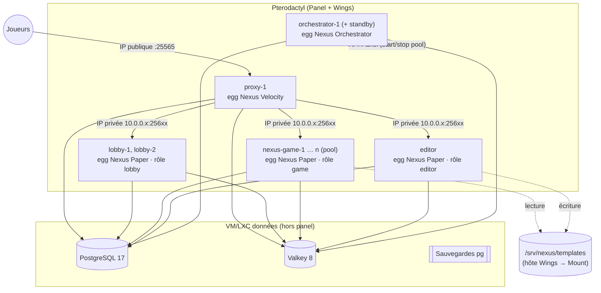

# 17 — Déploiement sur Pterodactyl

> **Document tenu à jour.** Toute modification qui change la façon de déployer (nouvelle variable d'environnement,
> nouveau port, nouveau plugin ou service, nouveau montage, changement de version Java/Paper/Velocity,
> changement de `nexus-boot.sh` ou des eggs) **met à jour ce fichier et `infra/pterodactyl/` dans le même commit**
> (règle 23 du `CLAUDE.md`). Dernière mise à jour du contenu : 2026-10-19.
>
> `infra/docker-compose.dev.yml` sert **uniquement au développement local** ; la production tourne sur Pterodactyl.

## 1. Topologie



| Serveur Pterodactyl | Egg | Rôle (`NEXUS_ROLE`) | Allocation | Ressources de départ |
|---|---|---|---|---|
| `proxy-1` | Nexus Velocity | `proxy` | **IP publique** `:25565` | 1 Go RAM, 100 % CPU |
| `lobby-1` (…) | Nexus Paper | `lobby` | IP privée, plage `25600-25699` | 3 Go, 200 % |
| `nexus-game-1` … `n` | Nexus Paper | `game` | IP privée | 6 Go, 400 %, 10 Go disque |
| `editor` | Nexus Paper | `editor` | IP privée (accès builders via le proxy) | 4 Go, 200 % |
| `orchestrator-1` (+ `orchestrator-2` standby) | Nexus Orchestrator | `orchestrator` | IP privée (port métriques) | 1 Go, 100 % |

PostgreSQL et Valkey tournent **hors du panel** (`infra/prod/docker-compose.data.yml`) : sauvegardes simples, pas de redémarrage accidentel depuis le panel, pas de port exposé publiquement.

## 2. Prérequis

- Pterodactyl Panel 1.11+ et Wings sur chaque nœud (vérifier la version installée et la noter ici : `__`).
- Un **réseau privé** entre nœuds Wings et la VM de données (ex. `10.0.0.0/24`, VLAN Proxmox).
- Sur chaque nœud Wings, ajouter les montages autorisés dans `/etc/pterodactyl/config.yml` puis redémarrer Wings :
  ```yaml
  allowed_mounts:
    - /srv/nexus
  ```
- Sur chaque nœud qui héberge des serveurs `game` : un tmpfs pour les mondes d'instance
  ```
  # /etc/fstab
  tmpfs  /srv/nexus/tmpfs  tmpfs  size=8g,mode=0777  0 0
  ```
  (un sous-dossier par serveur est créé automatiquement par nexus-core à partir de `NEXUS_SERVER_ID`).
- Dossier partagé des templates de maps : `/srv/nexus/templates` (NFS si plusieurs nœuds, ou S3 compatible — cf. §5).
- VM de données : Docker + `infra/prod/docker-compose.data.yml`, fichier `infra/prod/.env` (`NEXUS_APP_PASSWORD`) et `infra/prod/secrets/{pg_owner_password,valkey_password}` créés à la main (non versionnés).

## 3. Eggs

Fichiers : `infra/pterodactyl/eggs/`. Import : *Admin → Nests → créer le nest « Nexus » → Import Egg* pour chacun.

| Egg | Fichier | Image | Démarrage | Détection « prêt » | Arrêt |
|---|---|---|---|---|---|
| Nexus Paper | `egg-nexus-paper.json` | `ghcr.io/pterodactyl/yolks:java_25` ⚠ | `bash ./nexus-boot.sh` | `)! For help, type ` | `stop` |
| Nexus Velocity | `egg-nexus-velocity.json` | idem | `bash ./nexus-boot.sh` | `Done (` | `end` |
| Nexus Orchestrator | `egg-nexus-orchestrator.json` | idem | `bash ./nexus-boot.sh` | `Nexus orchestrator ready` | `^C` |

> ⚠ **À vérifier au premier déploiement** : la disponibilité du tag `yolks:java_25`. S'il n'existe pas, construire une image
> compatible yolks (base `eclipse-temurin:25-jre`, utilisateur `container`, `WORKDIR /home/container`, entrypoint yolks) et
> mettre à jour `docker_images` dans les 3 eggs.

**Installation (script d'egg, conteneur `installers:debian`)** :
- Paper : télécharge le build **STABLE** de `MINECRAFT_VERSION` (ou `PAPER_BUILD`) via l'API PaperMC **Fill v3**
  (`https://fill.papermc.io/v3/projects/paper/versions/<version>/builds`, en-tête `User-Agent` identifiant le projet obligatoire — d'où `NEXUS_CONTACT`), écrit `eula.txt`.
- Velocity : `VELOCITY_DOWNLOAD_URL` si renseignée, sinon Fill v3 projet `velocity` (**chemin à vérifier**).
- Tous : récupère `nexus-boot.sh` depuis `${NEXUS_RELEASE_URL}/${NEXUS_VERSION}/` (sinon le déposer par SFTP).
- Mettre à jour Paper/Velocity = changer la variable puis **Reinstall** du serveur.

### Variables communes

| Variable | Exemple | Visible joueur | Rôle |
|---|---|---|---|
| `NEXUS_ROLE` | `game` | oui | `lobby` / `game` / `editor` (Paper), `proxy`, `orchestrator` |
| `NEXUS_VERSION` | `0.3.0` / `latest` | oui | version des jars Nexus |
| `NEXUS_RELEASE_URL` | `https://releases.example.com/nexus` | oui | base HTTP des archives (vide = SFTP manuel) |
| `NEXUS_CONTACT` | `https://example.com` | oui | User-Agent des téléchargements |
| `NEXUS_DB_URL` / `NEXUS_DB_USER` / `NEXUS_DB_PASSWORD` | `jdbc:postgresql://10.0.0.2:5432/nexus`, `nexus_app` | **non** | BDD (utilisateur DML) |
| `NEXUS_REDIS_URL` | `redis://:***@10.0.0.2:6379` | **non** | Valkey |
| `JVM_FLAGS` | — | oui | options JVM additionnelles |

### Variables spécifiques

| Egg | Variable | Notes |
|---|---|---|
| Paper | `MINECRAFT_VERSION`, `PAPER_BUILD` | alignés sur `gradle.properties` (`minecraftVersion`) |
| Paper | `NEXUS_SERVER_ID` | unique ; pool de jeu : `nexus-game-<n>` = **External ID** du serveur dans le panel |
| Paper | `VELOCITY_SECRET` (masquée) | identique sur tout le réseau |
| Paper | `NEXUS_ADVERTISED_HOST` | IP privée annoncée à l'orchestrateur ; vide = `SERVER_IP` de l'allocation |
| Paper | `NEXUS_TEMPLATES_DIR` | `/mnt/nexus-templates` (Mount, §4) |
| Paper | `NEXUS_INSTANCES_DIR` | `/mnt/nexus-tmpfs` (Mount tmpfs, §4) |
| Paper | `NEXUS_MAX_INSTANCES` | serveurs `game` |
| Velocity | `VELOCITY_VERSION` / `VELOCITY_DOWNLOAD_URL`, `NEXUS_PROXY_ID`, `VELOCITY_SECRET` | |
| Orchestrator | `NEXUS_ORCHESTRATOR_ID`, `NEXUS_DB_MIGRATION_USER/PASSWORD` (propriétaire, DDL), `NEXUS_METRICS_PORT`, `NEXUS_SCALING_PROVIDER`, `PTERO_PANEL_URL`, `PTERO_APPLICATION_KEY`, `PTERO_CLIENT_KEY` | clés masquées |

Variables fournies par Pterodactyl et utilisées : `SERVER_MEMORY` (taille du tas = 90 %), `SERVER_IP`, `SERVER_PORT`.

## 4. Réseau, allocations, montages

- **Seul le proxy** a une allocation sur l'IP publique. Les backends (`online-mode=false`) ont leurs allocations sur l'**IP privée** du nœud ; le pare-feu de l'hôte refuse l'accès externe à la plage `25600-25699`. Le modern forwarding Velocity (secret) protège en plus.
- Chaque backend s'annonce à l'orchestrateur avec `NEXUS_ADVERTISED_HOST:SERVER_PORT` ; `nexus-proxy` enregistre dynamiquement les serveurs (aucune config Velocity à éditer lors d'un ajout).
- **Mounts** (*Admin → Mounts*), à associer aux eggs Nexus Paper et aux nœuds :

| Mount | Source (hôte) | Cible (conteneur) | Lecture seule | Serveurs |
|---|---|---|---|---|
| `nexus-templates-ro` | `/srv/nexus/templates` | `/mnt/nexus-templates` | oui | lobby, game |
| `nexus-templates-rw` | `/srv/nexus/templates` | `/mnt/nexus-templates` | **non** | editor |
| `nexus-tmpfs` | `/srv/nexus/tmpfs` | `/mnt/nexus-tmpfs` | non | game |

  Puis sur chaque serveur : *Admin → Servers → <serveur> → Mounts → ajouter*. (Les Mounts ne sont pas attachables par l'API : c'est une raison du mode **pool**, §6.)

## 5. Livraison des plugins

1. La CI (`./gradlew packageRelease`) produit dans `build/release/` :
   ```
   nexus-proxy.tar.gz         (+ .sha256)   jars/NexusProxy-*.jar, config/, VERSION
   nexus-lobby.tar.gz         (+ .sha256)   jars/NexusCore-*.jar, NexusLobby-*.jar, config/
   nexus-game.tar.gz          (+ .sha256)   jars/NexusCore-*.jar, NexusGame-*.jar (tous les jeux), config/
   nexus-editor.tar.gz        (+ .sha256)   jars/NexusCore-*.jar, NexusGame-*.jar, config/
   nexus-orchestrator.tar.gz  (+ .sha256)   jars/nexus-orchestrator.jar, config/
   nexus-boot.sh
   ```
   `config/` contient les configs de référence (`infra/config/paper/*`, `infra/config/nexus/*.example` renommés), **copiées seulement si absentes** sur le serveur.
2. Publier le dossier sur un serveur HTTP interne : `${NEXUS_RELEASE_URL}/<version>/` (+ alias `latest/`).
3. Au démarrage, `nexus-boot.sh` compare le SHA-256, remplace **uniquement** les jars Nexus (les plugins tiers comme spark sont conservés), injecte le secret Velocity, puis lance la JVM.
4. Mode manuel possible : `NEXUS_RELEASE_URL` vide, jars déposés par SFTP dans `plugins/` (ou `app/` pour l'orchestrateur).

Templates de maps : écrits par l'`editor` dans `/mnt/nexus-templates/<mode>/<map>/<version>.tar.zst` ; `map_versions.template_uri` = `file:///mnt/nexus-templates/...`. Plusieurs nœuds Wings → partager `/srv/nexus/templates` en NFS, ou passer le stockage en S3 compatible (MinIO) : `template_uri = s3://…` et `NEXUS_TEMPLATES_DIR` devient un cache local.

## 6. Scaling par l'orchestrateur (`ScalingProvider = pterodactyl`)

### Mode `pool` (recommandé)
- On crée à l'avance N serveurs `game` **arrêtés** (egg Nexus Paper, rôle `game`, mounts posés), avec *External ID* = `nexus-game-<n>`.
- L'orchestrateur liste le pool via l'API **Application** (`GET /api/application/servers/external/{external_id}`), démarre un serveur quand la capacité manque (`POST /api/client/servers/{identifier}/power` `{"signal":"start"}` via l'API **Client**) et arrête ceux vides depuis `idle-shutdown-minutes` (`signal: stop`, après `server.drain`), en gardant `min-running`.
- Avantages : démarrage en ~20–40 s, aucun téléchargement, mounts déjà configurés.

### Mode `create` (optionnel)
- `POST /api/application/servers` depuis l'egg (variables d'environnement, limites, `external_id`, allocation libre de la plage privée ou objet `deploy`, `start_on_completion: true`) ; suppression par `DELETE /api/application/servers/{id}`.
- Limites : installation à chaque création (plus lent) et **pas de Mounts** → impose le stockage S3 des templates et des mondes sur disque.

### Clés API
| Clé | Compte | Droits minimaux |
|---|---|---|
| `PTERO_APPLICATION_KEY` (`ptla_…`) | admin | lecture Servers, Nodes, Allocations ; écriture Servers seulement en mode `create` |
| `PTERO_CLIENT_KEY` (`ptlc_…`) | compte technique `nexus-bot` ajouté en sous-utilisateur des serveurs du pool | `control.start`, `control.stop` (et lecture des ressources) |

Les clés vivent uniquement dans les variables masquées de l'egg Orchestrator. Rotation : régénérer dans le panel, mettre à jour la variable, redémarrer l'orchestrateur.

## 7. Premier déploiement (checklist)

1. [ ] VM données : `docker compose -f infra/prod/docker-compose.data.yml up -d` ; vérifier `pg_isready`, `valkey-cli ping`.
2. [ ] Nœuds Wings : `allowed_mounts`, tmpfs, `/srv/nexus/templates`, pare-feu de la plage privée.
3. [ ] Panel : nest « Nexus », import des 3 eggs, création des 3 Mounts.
4. [ ] Publier une release (`packageRelease`) sur `NEXUS_RELEASE_URL`.
5. [ ] Créer `orchestrator-1` → démarrer → logs : migrations Flyway appliquées, `Nexus orchestrator ready`.
6. [ ] Créer `lobby-1`, `editor`, `nexus-game-1..n` (External ID), attacher les Mounts.
7. [ ] Créer `proxy-1` (allocation publique 25565) → se connecter avec un client 26.1.x.
8. [ ] Se donner le rôle `owner` (cf. `infra/README.md`), vérifier `/admin` → Réseau : tous les serveurs `READY`.
9. [ ] Construire/publier une map, activer un mode, lancer une partie test.

## 8. Mise à jour sans coupure

1. Publier la nouvelle release (`NEXUS_VERSION` sur les serveurs, ou `latest`).
2. **Orchestrateur** : redémarrer le standby d'abord, puis le leader (le standby prend la main via le verrou Redis).
3. **Serveurs de jeu** : *Hub admin → Réseau → Drainer* (ou laisser l'orchestrateur faire un roulement) → le serveur n'accepte plus d'instance, s'arrête une fois vide → **Restart** depuis le panel → `nexus-boot.sh` installe la nouvelle version.
4. **Lobbys** : un par un (les joueurs basculent sur l'autre lobby).
5. **Proxy** : en dernier, pendant une fenêtre calme (déconnecte les joueurs du proxy) — ou deux proxys derrière un DNS/LB pour un roulement complet.
6. Migrations de schéma : toujours **rétrocompatibles** avec la version précédente pendant le roulement (ajouter avant de retirer).

## 9. Sauvegardes & supervision

- Postgres : `pg-backup` (toutes les 6 h, rétention 7 j / 4 sem / 6 mois) dans `/srv/nexus/backups/postgres` → copier hors site.
- Templates de maps : sauvegarde du dossier `/srv/nexus/templates` (et Backups Pterodactyl activés sur `editor`).
- Valkey : aucune sauvegarde nécessaire (état reconstructible).
- Métriques : scraper `orchestrator-1:NEXUS_METRICS_PORT/metrics` (Prometheus/Grafana du homelab) ; spark sur chaque serveur Paper.

## 10. Dépannage

| Symptôme | Piste |
|---|---|
| Le serveur reste « Starting » | chaîne de détection « prêt » de l'egg ≠ log réel (orchestrateur : vérifier la ligne `Nexus orchestrator ready`) |
| `Unable to connect` depuis le proxy | `NEXUS_ADVERTISED_HOST` incorrect, pare-feu, `VELOCITY_SECRET` différent |
| `Schema validation failed` au démarrage d'un Paper | orchestrateur pas encore migré ou version de release différente |
| Mondes d'instance lents à créer | Mount tmpfs absent (`NEXUS_INSTANCES_DIR` sur disque) |
| `nexus-boot` : échec de synchronisation | `NEXUS_RELEASE_URL` injoignable depuis le nœud ; le serveur démarre avec les jars présents |
| L'orchestrateur ne démarre pas de serveur | droits de `PTERO_CLIENT_KEY` sur le serveur du pool, External ID mal saisi |

## 11. Historique des changements de déploiement

| Date | Changement |
|---|---|
| 2026-10-19 | Création : eggs Paper/Velocity/Orchestrator, `nexus-boot.sh`, mode pool, données hors panel |
